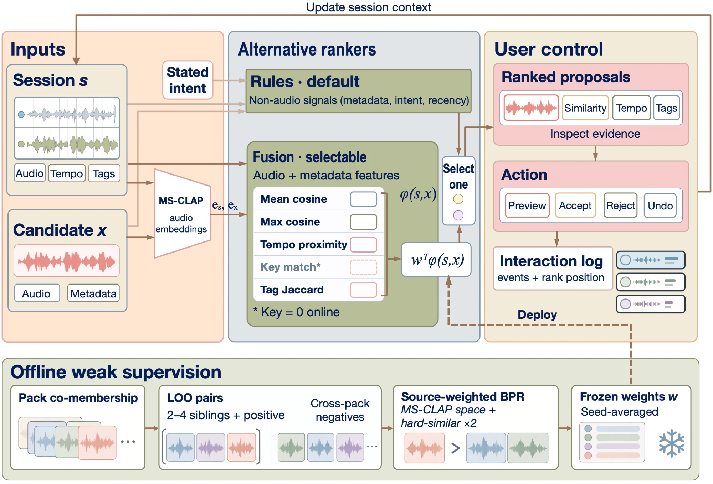

# Pocket Producer

[](https://ismir2026.ismir.net/)
[](LICENSE)
[](https://pocketproducer.vercel.app)

Sample recommendation for an open DAW session. Pocket Producer reads the
Audiotool project you are working on, ranks your own audio fragments by how
well they could fit that piece of music, shows the evidence behind each
suggestion, and lets you preview, insert, and undo.

Audio similarity is not the same as musical compatibility: two fragments can
sound alike and never belong in the same track. The ranker scores
compatibility with the session, and the musician makes the call.

- **Live demo:** [pocketproducer.vercel.app](https://pocketproducer.vercel.app)
  (needs an Audiotool account; the backend scales to zero, so the first
  visit after a quiet period takes a minute or two)
- **Paper:** *Pocket Producer: Session-Conditioned Retrieval as User-Controlled
  Proposal*, ISMIR 2026 Late-Breaking Demo ([CITATION.cff](CITATION.cff))
- **Video:** [youtu.be/s56Rp_1M9OE](https://youtu.be/s56Rp_1M9OE)



## How it works

1. **Session fingerprint.** Through the Audiotool Nexus SDK the app reads the
   open project: tempo, track roles, up to eight unique samples on the
   timeline, and an optional sentence of intent. Session audio is embedded
   with MS-CLAP on the server (CPU).
2. **Two rankers.** The default `rules-v1` scores seven non-audio signals
   (tempo fit, key, role gap, stated intent, tag overlap, tag novelty,
   recency). The selectable `fusion-5sig-v1` is a linear fusion of mean and
   max CLAP cosine, tempo, key, and tag Jaccard, with weights trained by
   Bayesian Personalized Ranking on pack co-membership. Audiotool exposes no
   project key, so the key signal is zero online.
3. **Proposals, not decisions.** Every candidate carries per-signal evidence
   chips. Insert writes the sample in one Nexus transaction at the start of
   the timeline; undo removes exactly the entities that insert created.
   Previews, accepts, rejects, inserts, and undos are logged with rank
   position for future supervision.

Details: [ARCHITECTURE.md](ARCHITECTURE.md), [MODEL_CARD.md](MODEL_CARD.md),
[VERIFICATION.md](VERIFICATION.md). The Nexus SDK patch shipped in
`frontend/patches/` is explained in [docs/nexus-bug-report.md](docs/nexus-bug-report.md).

## Evaluation

There are no labels for "these two fragments belong in the same piece", so
the learned ranker is trained and evaluated on pack co-membership in the
Freesound Loop Dataset: 1,797 loops from 605 packs, one pack per source,
with a frozen 121-source held-out split (seed 20260810). The metric is
pairwise accuracy; every number below comes from a versioned JSON under
[`artifacts/`](artifacts/).

**Dev set** (5 source-grouped splits,
[`artifacts/fusion-packonly/fusion.json`](artifacts/fusion-packonly/fusion.json)):

| | overall | hard_similar |
|---|---:|---:|
| frozen CLAP cosine | 0.929 | 0.8136 |
| five-signal fusion | 0.925 | 0.8133 |

On an earlier corpus that also grouped loops by uploader, fusion led cosine
by +4.0 pp on hard_similar negatives; restricting to true pack co-membership
removes the gain. The label construction, not the ranker, produced it.

**Held-out** (fusion minus cosine, 5-seed mean, 95% bootstrap CI,
reported as exploratory after a corrected training protocol):

| Negative regime | LAION-CLAP, plain BPR | MS-CLAP, source-weighted BPR |
|---|---:|---:|
| hard_similar | +2.1 pp [−1.0, +5.3] | +9.9 pp [+4.4, +15.4] |
| overall | +0.6 pp [−0.4, +1.6] | +2.6 pp [+1.0, +4.2] |

The two columns differ in embedding space, training recipe, and mined
negatives, so the gap shows configuration sensitivity, not which model is
better. That is why the deployed system treats scores as proposals and
keeps the rules ranker as the default. Follow-up checks, including the
negative results, are in [research/README.md](research/README.md); the
dataset's per-item licenses are in [DATA_CREDITS.md](DATA_CREDITS.md).

## Run it locally

```bash
# Backend (Python 3.11+)
cd backend
python -m venv .venv && ./.venv/bin/pip install -r requirements.txt pytest ruff
cp .env.example .env                       # fill in credentials
./.venv/bin/pytest -q && ./.venv/bin/ruff check .
POCKET_ENABLE_CLAP=1 ./.venv/bin/uvicorn api.main:app --reload --port 8080
```

`POCKET_ENABLE_CLAP=1` needs the CLAP stack, installed the way the
Dockerfile does it:

```bash
./.venv/bin/pip install --index-url https://download.pytorch.org/whl/cpu "torch==2.13.0" "torchaudio==2.11.0" "torchcodec==0.15.0"
./.venv/bin/pip install "msclap>=1.3,<2"
```

```bash
# Frontend
cd frontend
pnpm install                 # pnpm is required: it applies patches/ to @audiotool/nexus
cp .env.example .env.local   # API URL, Firebase web config, Audiotool client id
pnpm run check               # eslint + tsc + vitest
pnpm run dev                 # http://127.0.0.1:3000 (Audiotool rejects localhost redirect URIs)
```

Deployment goes through `backend/deploy/deploy.sh` (Cloud Run) and
`vercel --prod` (frontend); see [docs/MAINTAINING.md](docs/MAINTAINING.md).

## Reproducing the paper

`python research/check_paper_numbers.py` cross-checks the committed
artifacts with no download. Rebuilding the artifacts takes two stages:

1. Download the Freesound Loop Dataset from
   [Zenodo 3967852](https://zenodo.org/records/3967852) and build the
   embedding files with the commands in
   [research/README.md](research/README.md). Nothing derived from that audio
   is redistributed here.
2. Re-run the result chain:

   ```bash
   python -m venv .venv && source .venv/bin/activate
   python -m pip install -r backend/requirements.txt
   python research/reproduce.py        # about 20 minutes on a laptop CPU
   ```

   From the original embedding files every artifact matches to 1e-6;
   regenerated embeddings differ slightly because the embedding models pick
   their analysis window at random.

## Repository layout

| Path | Contents |
|---|---|
| `backend/ranking/` | Rankers, signals, CLAP adapters, ingest |
| `backend/api/` | FastAPI app: ranking, fragments, projects, session embedding |
| `backend/agents/` | Gemini-based tagging and project grouping for the capture flow |
| `frontend/src/app/audiotool/`, `frontend/src/lib/audiotool/` | Session reading, ranking UI, insert and undo |
| `research/` | Evaluation scripts, protocols, reproduction |
| `artifacts/` | Versioned results and the deployed fusion weights |

## License

Code is Apache 2.0 ([LICENSE](LICENSE)). The paper is CC BY-NC 4.0. Cite
with [CITATION.cff](CITATION.cff).
