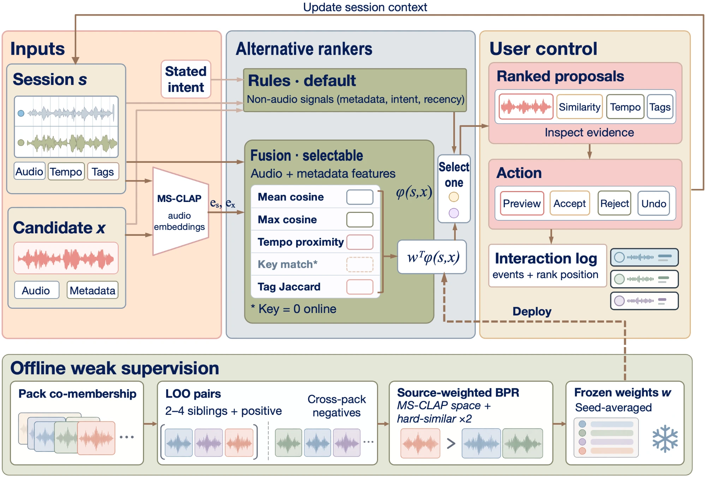

# Pocket Producer

[](https://ismir2026.ismir.net/)
[](LICENSE)
[](https://pocketproducer.vercel.app)

Pocket Producer brings old musical sketches back when they might be useful.
It reads the Audiotool project you have open, ranks your own recorded
fragments by how well they could fit it, shows the measurements behind each
suggestion, and lets you preview a fragment, insert it and undo the insert.

- **Video** of preview, insert and undo in the DAW:
  [youtu.be/i8HUDhZYcdE](https://youtu.be/i8HUDhZYcdE)
- **Reproduction guide:** [docs/portfolio/REPRODUCE.md](docs/portfolio/REPRODUCE.md)
- **Paper:** *Pocket Producer: Session-Conditioned Retrieval as User-Controlled
  Proposal*, ISMIR 2026 Late-Breaking Demo ([CITATION.cff](CITATION.cff))
- **Live app:** [pocketproducer.vercel.app](https://pocketproducer.vercel.app).
  It needs an Audiotool account, and the backend sleeps when idle, so the
  first request after a quiet spell can take a minute or two.



*The figure is from the ISMIR demo and shows the rules and fusion rankers;
Beat Fit came later.*

## How it works

**Reading the session.** Through the Audiotool Nexus SDK the app reads the
open project's tempo, its track types, the samples placed on the timeline
(up to eight) and an optional line of intent that you type. Rankers that
compare candidates with the sound of the session get those samples, embedded
with MS-CLAP on the server. The default ranker does not use them, so nothing
is sent for it.

The descriptions below cover the current source. The linked demo predates the
shared-beat rhythm measurement and the update that preserves copied regions on Undo.

**Ranking.** Nine rankers can be chosen in the panel: `rules-v1`,
`recency-v1`, `mean-session-v1`, `text-only-v1`, `audio-cosine-v1`,
`role-gap-v1`, `harmonic-fit-v1`, `beat-fit-v1` and `fusion-5sig-v1`.
`rules-v1` is the default and combines seven hand-weighted signals (tempo,
key, a missing instrument role, the typed intent, tag overlap, tag novelty and
recency). `fusion-5sig-v1` combines mean and max CLAP cosine, tempo, key and
tag overlap, with weights learned by Bayesian Personalized Ranking from loops
that share a sample pack. `beat-fit-v1` puts the session and a candidate on
one beat grid and compares their harmony and onset patterns on the beats where
both sound. Two recordings can pause together even when the accents in their
playing differ. The original research measured onset correlation across the
whole window, including those pauses. The reported retrieval scores describe
that original measurement. Audiotool supplies no project key, so the rankers
can use a key you specify in the intent. Beat Fit needs stored beat frames
for each candidate.

**Trying a suggestion.** The panel ranks up to 200 sketches from the current
library page. Choose **Older sketches** to try the same settings on earlier
recordings. Skip a sketch and the next round draws from the ones you haven't
skipped for this intent. Each suggestion lists its evidence. Insert places the recording
at the start of the timeline. If you copy that region to a later bar and then
undo the original insertion, your copy keeps its track and sample. Feedback
records which list you saw and what you tried. The offline training prototype
uses recorded inserts and undos to distinguish a retained suggestion from one
you removed in the panel. Edits made directly in the DAW, including copying a
region or deleting it later, are outside that feedback log.

**Grouping sketches into projects.** Separately from ranking, captured
fragments are grouped into projects by feeling and theme. Gemini makes that
call from the tags, the text and the notes and edits you have made, and is
shown the fusion score as a hint of how alike two recordings sound. Nobody
has checked this against how musicians group their own work. The modes are
described in [ARCHITECTURE.md](ARCHITECTURE.md#who-decides-grouping).

Sounding alike and fitting together are different things: two loops can be
close in every embedding and still not belong in the same track. The scores
measure particular relationships with the session, and whether musicians
would pick the same fragments has not been tested, so the app suggests and
the musician decides.

## Where to read the code

- [`backend/ranking/beat_sync.py`](backend/ranking/beat_sync.py),
  `session_beats` and `candidate_measurements`: placing the session and a
  candidate on one beat grid.
- [`backend/ranking/beat_fit_ranker.py`](backend/ranking/beat_fit_ranker.py),
  `BeatFitRanker.rank`: turning those measurements into a ranking and the
  evidence shown with it.
- [`frontend/src/lib/audiotool/insert-fragment.ts`](frontend/src/lib/audiotool/insert-fragment.ts),
  `insertFragment` and `undoInsert`: inserting a sample in one transaction and
  preserving later copies when the original insertion is undone.

MS-CLAP, librosa's chroma and onset analysis and the Nexus SDK are existing
tools. What was built here is how they are tied to the open session, how the
evidence is shown, and the reversible insert.

More detail: [ARCHITECTURE.md](ARCHITECTURE.md), [MODEL_CARD.md](MODEL_CARD.md),
[VERIFICATION.md](VERIFICATION.md). The patch to the Nexus SDK in
`frontend/patches/` is explained in [docs/nexus-bug-report.md](docs/nexus-bug-report.md).

## Evaluation

There are no labels for "these two fragments belong in the same piece", so
the learned ranker is trained and evaluated on pack co-membership in the
Freesound Loop Dataset: 1,797 loops from 605 packs, one pack per source,
with a frozen 121-source held-out split (seed 20260810). The metric is
pairwise accuracy; every number below comes from a versioned JSON under
[`artifacts/`](artifacts/).

**Dev set** (5 source-grouped splits,
[`artifacts/fusion-packonly/fusion.json`](artifacts/fusion-packonly/fusion.json)):

| | overall | hard_similar |
|---|---:|---:|
| frozen CLAP cosine | 0.929 | 0.8136 |
| five-signal fusion | 0.925 | 0.8133 |

On an earlier corpus that also grouped loops by uploader, fusion led cosine
by +4.0 pp on hard_similar negatives. With true pack co-membership the gain
disappears, so it came from how the labels were built rather than from the
ranker.

**Held-out** (fusion minus cosine, 5-seed mean, 95% bootstrap CI,
reported as exploratory after a corrected training protocol):

| Negative regime | LAION-CLAP, plain BPR | MS-CLAP, source-weighted BPR |
|---|---:|---:|
| hard_similar | +2.1 pp [−1.0, +5.3] | +9.9 pp [+4.4, +15.4] |
| overall | +0.6 pp [−0.4, +1.6] | +2.6 pp [+1.0, +4.2] |

The two columns differ in embedding space, training recipe, and mined
negatives, so the gap shows configuration sensitivity, not which model is
better. This is one reason the rules ranker stays the default and every
score is offered as a suggestion. The split groups by pack, not by
uploader: 58 of the 121 held-out packs come from uploaders who also have
packs on the train side. On the 25 query packs without such an uploader
(135 hard_similar queries) the advantage is +3.9 pp [−1.9, +10.3] under
MS-CLAP and +0.3 pp [−4.4, +4.6] under LAION-CLAP
([`artifacts/uploader-overlap-check/`](artifacts/uploader-overlap-check/),
post hoc, same pairs and weights). The subset is too small to say whether the
+9.9 pp depends on recognising uploaders. Follow-up checks, including the
negative results, are in [research/README.md](research/README.md); the
dataset's per-item licenses are in [DATA_CREDITS.md](DATA_CREDITS.md).

**Fit evidence for ranking** (MUSDB18-HQ, given one stem, find the context
it fits among 50 missing the same stem type): beat-aligned chroma plus onset
pattern ranks the true context first in 54.0% of 594 stems [49.6, 58.4],
MS-CLAP cosine in 14.1% and the deployed fusion in 20.7%
([results](research/results-assignment-v1.md)). Same recordings as the
behavioural and retrieval studies, onset combination chosen post hoc, studio
stems with a steady beat; one of seven predictions (A1) was not supported.

## Run it locally

```bash
# Backend (Python 3.11+)
cd backend
python -m venv .venv && ./.venv/bin/pip install -r requirements.txt pytest ruff
cp .env.example .env                       # fill in credentials
./.venv/bin/pytest -q && ./.venv/bin/ruff check .
POCKET_ENABLE_CLAP=1 ./.venv/bin/uvicorn api.main:app --reload --port 8080
```

`POCKET_ENABLE_CLAP=1` needs the CLAP stack, installed the way the
Dockerfile does it:

```bash
./.venv/bin/pip install --index-url https://download.pytorch.org/whl/cpu "torch==2.13.0" "torchaudio==2.11.0" "torchcodec==0.15.0"
./.venv/bin/pip install "msclap>=1.3,<2"
```

```bash
# Frontend
cd frontend
pnpm install                 # pnpm is required: it applies patches/ to @audiotool/nexus
cp .env.example .env.local   # API URL, Firebase web config, Audiotool client id
pnpm run check               # eslint + tsc + vitest
pnpm run dev                 # http://127.0.0.1:3000 (Audiotool rejects localhost redirect URIs)
```

Deployment goes through `backend/deploy/deploy.sh` (Cloud Run) and
`vercel --prod` (frontend); see [docs/MAINTAINING.md](docs/MAINTAINING.md).

## Reproducing the paper

`python research/check_paper_numbers.py` cross-checks the committed
artifacts with no download. Rebuilding the artifacts takes two stages:

1. Download the Freesound Loop Dataset from
   [Zenodo 3967852](https://zenodo.org/records/3967852) and build the
   embedding files with the commands in
   [research/README.md](research/README.md). Nothing derived from that audio
   is redistributed here.
2. Re-run the result chain:

   ```bash
   python -m venv .venv && source .venv/bin/activate
   python -m pip install -r backend/requirements.txt
   python research/reproduce.py        # about 20 minutes on a laptop CPU
   ```

   From the original embedding files every artifact matches to 1e-6;
   regenerated embeddings differ slightly because the embedding models pick
   their analysis window at random.

## Repository layout

| Path | Contents |
|---|---|
| `backend/ranking/` | Rankers, signals, CLAP adapters, ingest |
| `backend/api/` | FastAPI app: ranking, fragments, projects, session embedding |
| `backend/agents/` | Gemini agents for project grouping (tagging is a direct Gemini call in `backend/api/pipeline/`) |
| `frontend/src/app/audiotool/`, `frontend/src/lib/audiotool/` | Session reading, ranking UI, insert and undo |
| `research/` | Evaluation scripts, protocols, reproduction |
| `artifacts/` | Versioned results and the deployed fusion weights |

## License

Code is Apache 2.0 ([LICENSE](LICENSE)). The paper is CC BY-NC 4.0. Cite
with [CITATION.cff](CITATION.cff).
