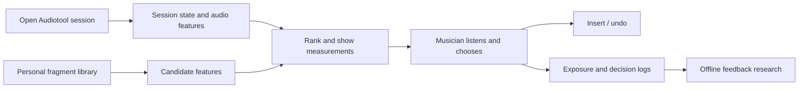

# Pocket Producer

A system for trying personal audio fragments in an open music-production
session, with visible ranking measurements and reversible insertion.

The musical problem is practical: a library fragment may sound similar to
an arrangement yet add little to it. The system reads an Audiotool project,
compares candidates from the musician's own library, and lets the musician
preview a proposal, insert it and undo that insertion. A recommendation is
an invitation to listen; a numerical score does not settle the musical choice.

## System contribution

The repository combines DAW state and audio access, signal extraction,
ranking, evidence display and a transaction-based insert/undo path. Its
research contribution is an evaluation design that asks when similarity
fails to capture particular musical constraints, and records negative
results that affect product choices.

Existing components include Audiotool/Nexus, MS-CLAP, librosa and standard
chroma/onset methods. Beat-synchronous chroma and transposition matching
have established precedents, including [Ellis and Poliner, 2007](https://www.ee.columbia.edu/~graham/papers/EllisP07-coversongs.pdf).
The project does not claim to invent these representations. Its distinctive
work lies in the system integration, controlled tests, failure analysis and
reversible interaction design.

## One result and one negative result

On the 402 MUSDB18-HQ stem/context pairs whose harmony changes across the
shift (of 594 pairs from 149 songs), beat-aligned chroma preferred the
reference to a four-beat-delayed target with a win rate of
**0.74 [0.69, 0.78]**, versus **0.45 [0.39, 0.49]** for mean chroma. This
supports investigating temporal harmony information in this task. It is not
a pure permutation test: a fixed delayed window replaces some content with
earlier audio, and its energy/pitch-class profile can change. Intervals
resample whole songs and are pointwise without multiplicity correction.
Source: [behavioural results](../../research/results-behavioral-v1.md), P4.

In same-role retrieval among 50 stems, onset alone reached Recall@1
**53.20%**, while chroma plus onset reached **52.69%**. There is no paired
interval for their difference, so this does not establish a significant
loss; it also provides no demonstrated incremental benefit from adding
chroma. Exposing harmony alongside rhythm remains a design choice to test,
not an established superiority claim. Source: [retrieval results](../../research/results-retrieval-v1.md).

The retrieval task is **as-is layering**: the true stem shares the context's
song and time window; other-song candidates retain their own tempo, phase,
key and phrase. These results do not establish musician preference or loop
retrieval after adaptation. Processing controls and window-selection bias
also limit causal interpretation. The frozen protocols retain their original
text with dated corrections; result JSON and tables were not changed.

## What can be shown truthfully

| Capability | Evidence and state |
|---|---|
| DAW session reading, proposals, preview, insert and undo | Existing implementation and tests; this revision has no live DAW verification |
| Five-signal fusion | Existing five-signal scoring contract; no change to shipped weights; registered in the live service (`/ready`) |
| Beat-fit / beat-frame ingestion | Registered and deployed as a selectable ranker, with support checks and factual measurement labels; scores only fragments that have stored beat frames |
| Frame backfill for existing fragments | Script available; production backfill not executed |
| Feedback training | Offline prototype; named vectors, masks and a behavioural guardrail; no automatic online adaptation |
| Seven-signal learned fusion | Research-only artifact, refused by the five-signal online loader |
| Who decides grouping | `POCKET_GROUPING_MODE`: `llm` (default, deployed) lets Gemini agents decide; `fusion` lets the fusion score against a threshold calibrated on the pack split decide, with Gemini writing only the narrative, title and next action; `hybrid` lets Gemini decide while shown the fusion scores and what the fusion rule would choose, recording whether they agree. The threshold comes from pack co-membership, not user grouping data ([results](../../research/results-grouping-threshold-v1.md)); neither non-default mode is deployed |
| The user's edits as context | Behind `POCKET_EDIT_CONTEXT=1`, off by default: Gemini is shown a code-compiled summary of the user's own edits (tags added or removed, titles replaced, suggestions completed or skipped) when writing tags, titles, suggestions and grouping decisions. Prompt conditioning, not training; not covered by the behavioural guardrail; effect not evaluated |
| Chord-transition continuation ideas | Future study; not a completed v1 result |

Beat-fit labels report a raw chroma cosine or signed onset correlation,
shared-beat support and tied values where appropriate. Relative score
contributions are separate. No common sounding time produces no alignment
claim. Region offsets, loops, effects and mixing are not fully represented;
there is no claim of equivalence to real DAW playback.

Recording and demo production are outside this revision's scope.

## Deeper materials

Start with this note, then consult [reproduction instructions](REPRODUCE.md),
and the [research corrections](../../research/protocol-retrieval-v1.md#deviations).
No login, external disk or running backend is needed to read these materials.
